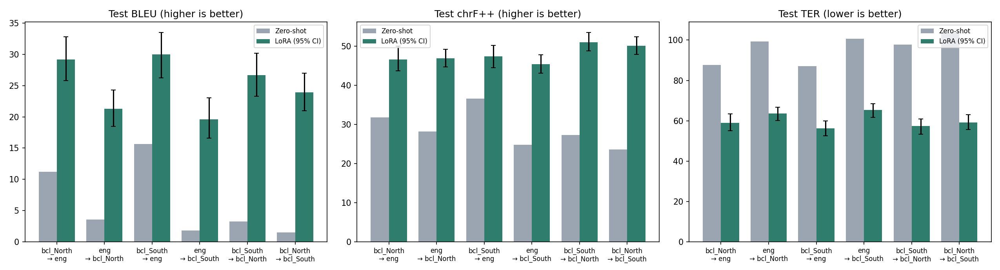
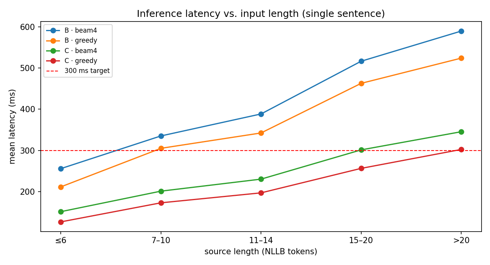
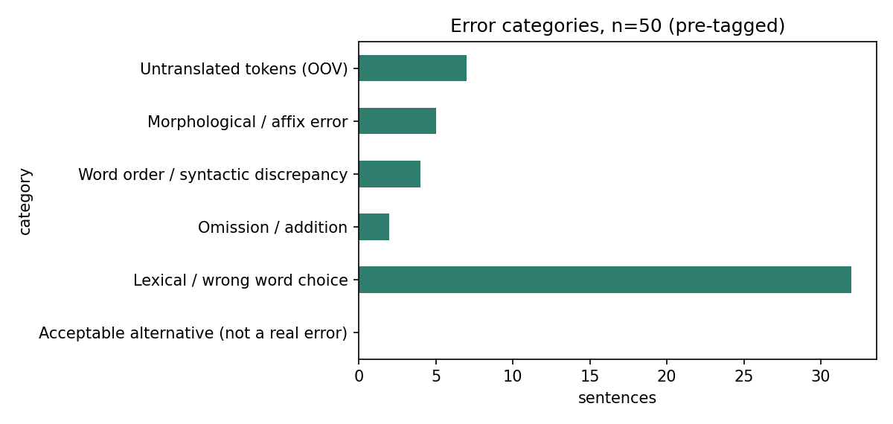

# Phase 4 Report — Quantitative Evaluation & Error Analysis

*Northern (Pandan) / Southern (Virac) Catanduanes Bikol ↔ English · NLLB-200-distilled-600M + LoRA (r=32, α=64, best epoch 18)*

## 1. Evaluation setup

- **Held-out test set:** 235 aligned sentence trios from the Phase 1 leakage-grouped 70/15/15 split (seed 42), i.e. 235 pairs in each of 6 directions. The test set was not used for training, early stopping or model selection.
- **Systems:** zero-shot `facebook/nllb-200-distilled-600M` (un-tuned; Pandan→`tgl_Latn`, Virac→`war_Latn`, English→`eng_Latn`) vs. the same model with the LoRA adapter merged.
- **Decoding:** beam 4, max source length 64 tokens, max 96 new tokens, fp16 autocast.
- **Metrics (SacreBLEU):** `nrefs:1|case:mixed|eff:no|tok:13a|smooth:exp|version:2.6.0`; `nrefs:1|case:mixed|eff:yes|nc:6|nw:2|space:no|version:2.6.0`; `nrefs:1|case:lc|tok:tercom|norm:no|punct:yes|asian:no|version:2.6.0`.
- **Uncertainty:** 300 paired bootstrap resamples over test sentences (95 % percentile intervals).

## 2. Task 4.1 — Test-set metrics

| Direction | System | n | BLEU | chrF++ | TER |
|---|---|---|---|---|---|
| bcl_North → eng | Zero-shot NLLB-600M | 235 | 11.2 [8.6–13.7] | 31.8 [29.3–34.6] | 87.6 [83.3–91.2] |
| bcl_North → eng | LoRA fine-tuned | 235 | 29.2 [25.8–32.8] | 46.6 [43.6–50.0] | 59.0 [55.0–63.4] |
| eng → bcl_North | Zero-shot NLLB-600M | 235 | 3.5 [2.0–5.1] | 28.2 [26.7–29.8] | 99.2 [95.2–102.7] |
| eng → bcl_North | LoRA fine-tuned | 235 | 21.3 [18.5–24.3] | 46.8 [44.7–49.2] | 63.5 [60.1–66.8] |
| bcl_South → eng | Zero-shot NLLB-600M | 235 | 15.7 [12.6–19.1] | 36.6 [33.9–39.3] | 87.1 [77.4–99.4] |
| bcl_South → eng | LoRA fine-tuned | 235 | 30.0 [26.2–33.5] | 47.3 [44.4–50.1] | 56.2 [52.5–59.8] |
| eng → bcl_South | Zero-shot NLLB-600M | 235 | 1.8 [1.0–2.7] | 24.8 [23.6–25.8] | 100.7 [97.9–103.9] |
| eng → bcl_South | LoRA fine-tuned | 235 | 19.6 [16.6–23.0] | 45.3 [43.1–47.7] | 65.3 [61.7–68.5] |
| bcl_South → bcl_North | Zero-shot NLLB-600M | 235 | 3.2 [1.9–4.5] | 27.3 [25.9–28.9] | 97.7 [94.7–101.3] |
| bcl_South → bcl_North | LoRA fine-tuned | 235 | 26.7 [23.3–30.2] | 51.0 [48.7–53.5] | 57.4 [53.4–60.9] |
| bcl_North → bcl_South | Zero-shot NLLB-600M | 235 | 1.5 [1.0–2.4] | 23.6 [22.7–24.8] | 103.8 [100.3–107.3] |
| bcl_North → bcl_South | LoRA fine-tuned | 235 | 23.9 [21.0–27.0] | 50.0 [47.8–52.3] | 59.1 [55.7–63.1] |

Copy-source reference for the dialect↔dialect directions:

| direction | system | n | BLEU | chrF++ | TER |
|---|---|---|---|---|---|
| bcl_South → bcl_North | Copy source (no translation) | 235 | 18.0 | 47.3 | 67.0 |
| bcl_North → bcl_South | Copy source (no translation) | 235 | 18.1 | 47.0 | 64.8 |

## 3. Task 4.2 — Benchmark: zero-shot vs. LoRA

| Direction | BLEU zero-shot | BLEU LoRA | ΔBLEU | p(BLEU) | chrF++ zero-shot | chrF++ LoRA | ΔchrF++ | p(chrF++) | TER zero-shot | TER LoRA | ΔTER | p(TER) | val BLEU (LoRA) | val chrF++ (LoRA) | val TER (LoRA) |
|---|---|---|---|---|---|---|---|---|---|---|---|---|---|---|---|
| bcl_North → eng | 11.2 | 29.2 | 18.0 | 0.0 | 31.8 | 46.6 | 14.8 | 0.0 | 87.6 | 59.0 | -28.5 | 0.0 | 27.4 | 45.0 | 63.8 |
| eng → bcl_North | 3.5 | 21.3 | 17.8 | 0.0 | 28.2 | 46.8 | 18.7 | 0.0 | 99.2 | 63.5 | -35.7 | 0.0 | 21.5 | 45.9 | 67.2 |
| bcl_South → eng | 15.7 | 30.0 | 14.3 | 0.0 | 36.6 | 47.3 | 10.8 | 0.0 | 87.1 | 56.2 | -30.8 | 0.0 | 27.2 | 46.8 | 59.6 |
| eng → bcl_South | 1.8 | 19.6 | 17.8 | 0.0 | 24.8 | 45.3 | 20.5 | 0.0 | 100.7 | 65.3 | -35.4 | 0.0 | 21.3 | 45.1 | 64.5 |
| bcl_South → bcl_North | 3.2 | 26.7 | 23.4 | 0.0 | 27.3 | 51.0 | 23.7 | 0.0 | 97.7 | 57.4 | -40.4 | 0.0 | 25.2 | 50.3 | 61.0 |
| bcl_North → bcl_South | 1.5 | 23.9 | 22.4 | 0.0 | 23.6 | 50.0 | 26.4 | 0.0 | 103.8 | 59.1 | -44.8 | 0.0 | 24.2 | 47.9 | 62.9 |
| MEAN of 6 directions | 6.2 | 25.1 | 19.0 |  | 28.7 | 47.9 | 19.1 |  | 96.0 | 60.1 | -35.9 |  | 24.5 | 46.8 | 63.2 |
| mean: → English (Bikol→eng) | 13.4 | 29.6 | 16.2 |  | 34.2 | 47.0 | 12.8 |  | 87.3 | 57.6 | -29.7 |  | 27.3 | 45.9 | 61.7 |
| mean: → Bikol (eng→Bikol) | 2.7 | 20.4 | 17.8 |  | 26.5 | 46.1 | 19.6 |  | 100.0 | 64.4 | -35.6 |  | 21.4 | 45.5 | 65.9 |
| mean: Dialect↔dialect | 2.4 | 25.3 | 22.9 |  | 25.5 | 50.5 | 25.1 |  | 100.8 | 58.2 | -42.6 |  | 24.7 | 49.1 | 62.0 |

`Δ` = LoRA − zero-shot (for TER a negative Δ is an improvement). `p` = paired-bootstrap share of resamples in which LoRA was not better.

### Latency (inference time per input length)

| variant | mode | n | mean_ms | median_ms | p95_ms | pct_under_target | ms_per_out_token |
|---|---|---|---|---|---|---|---|
| B: merged fp32 + AMP (API default) | beam4 | 200 | 417.2 | 372.7 | 738.7 | 28.0 | 27.6 |
| B: merged fp32 + AMP (API default) | greedy | 200 | 369.2 | 332.5 | 649.5 | 40.5 | 24.1 |
| C: merged fp16 | beam4 | 200 | 245.9 | 223.4 | 416.8 | 73.0 | 16.2 |
| C: merged fp16 | greedy | 200 | 211.0 | 185.3 | 396.8 | 83.0 | 13.8 |

Mean latency (ms) by source length (NLLB tokens):

| variant | mode | ≤6 | 7–10 | 11–14 | 15–20 | >20 |
|---|---|---|---|---|---|---|
| B: merged fp32 + AMP (API default) | beam4 | 256.0 | 335.0 | 389.0 | 517.0 | 590.0 |
| B: merged fp32 + AMP (API default) | greedy | 211.0 | 305.0 | 342.0 | 463.0 | 524.0 |
| C: merged fp16 | beam4 | 151.0 | 201.0 | 230.0 | 301.0 | 345.0 |
| C: merged fp16 | greedy | 126.0 | 173.0 | 197.0 | 256.0 | 302.0 |

## 4. Task 4.3 — Linguistic error analysis

Sample: 50 mistranslated LoRA outputs (exact-match excluded, sentence chrF++ < 50), stratified over the six directions, seed 42. **Category source: AUTOMATIC PRE-TAG ONLY — NOT YET REVIEWED BY A HUMAN.**

| category | sentences | % |
|---|---|---|
| Untranslated tokens (OOV) | 7 | 14.0 |
| Morphological / affix error | 5 | 10.0 |
| Word order / syntactic discrepancy | 4 | 8.0 |
| Omission / addition | 2 | 4.0 |
| Lexical / wrong word choice | 32 | 64.0 |
| Acceptable alternative (not a real error) | 0 | 0.0 |

| category | bcl_North → bcl_South | bcl_North → eng | bcl_South → bcl_North | bcl_South → eng | eng → bcl_North | eng → bcl_South |
|---|---|---|---|---|---|---|
| Untranslated tokens (OOV) | 2 | 0 | 5 | 0 | 0 | 0 |
| Morphological / affix error | 1 | 1 | 0 | 0 | 1 | 2 |
| Word order / syntactic discrepancy | 0 | 0 | 0 | 0 | 2 | 2 |
| Omission / addition | 0 | 1 | 0 | 1 | 0 | 0 |
| Lexical / wrong word choice | 5 | 7 | 3 | 7 | 6 | 4 |
| Acceptable alternative (not a real error) | 0 | 0 | 0 | 0 | 0 | 0 |

Illustrative examples:

- **Untranslated tokens (OOV)** (bcl_South → bcl_North)  
  source: *Linigan mo ang lamesa mo pagkatapos mong magkaon.*  
  reference: *Limpyahan mo yang imong lamesa pakatapos mo magkaon ning snack.*  
  system: *Linigan mo yu lamesa pagkatapos magkaon.*  
  note: copied from source: linigan, pagkatapos // near-miss: 'pagkatapos' vs ref 'pakatapos' (prefix pag- → pa-)

- **Morphological / affix error** (bcl_North → eng)  
  source: *Ikan ka man ning mga gwantes na pangtinaman?*  
  reference: *Do you also have gardening gloves?*  
  system: *Do you have garden ornaments?*  
  note: near-miss: 'garden' vs ref 'gardening' (suffix -∅ → -ing)

- **Word order / syntactic discrepancy** (eng → bcl_North)  
  source: *Rest well tonight after a long walk.*  
  reference: *Pahingaro ka na nintong gabi pakatapos ning harawig na pagpanaw.*  
  system: *Magdiskanso ka ning turtor nintong gabi pakatapos maglakaw.*  
  note: 1 correct word(s) in wrong position

- **Omission / addition** (bcl_North → eng)  
  source: *Dunggon mo aban-aban.*  
  reference: *You should listen to it later.*  
  system: *Please listen carefully.*  
  note: length hyp/ref = 3/6 words

- **Lexical / wrong word choice** (bcl_North → eng)  
  source: *Hunas yu dagat.*  
  reference: *The tide is low.*  
  system: *The sea is cold.*  
  note: 

Heuristic profile over all mistranslated test sentences (zero-shot vs. LoRA):

| system | Untranslated tokens (OOV) | Morphological / affix error | Word order / syntactic discrepancy | Omission / addition | Lexical / wrong word choice |
|---|---|---|---|---|---|
| LoRA | 13.9 | 7.6 | 7.6 | 5.0 | 65.8 |
| Zero-shot | 15.2 | 3.7 | 3.2 | 8.1 | 69.9 |

## 5. Discussion (computed statements — extend with your own interpretation)

- Averaged over the six directions, fine-tuning raised BLEU from 6.2 to 25.1, chrF++ from 28.7 to 47.9, and lowered TER from 96.0 to 60.1.
- Best direction by BLEU: bcl_South → eng (30.0); weakest: eng → bcl_South (19.6).
- The paired bootstrap found LoRA better than zero-shot in 18 of 18 direction×metric comparisons at p < 0.05.
- Mean test BLEU 25.1 vs. mean validation BLEU 24.5 (difference +0.6); each direction's 95 % CI half-width is about ±3–4 BLEU with 235 sentences, so differences smaller than that are not reliable.
- bcl_South → bcl_North: LoRA chrF++ 51.0 vs. 47.3 for simply copying the source (BLEU 26.7 vs. 18.0).
- bcl_North → bcl_South: LoRA chrF++ 50.0 vs. 47.0 for simply copying the source (BLEU 23.9 vs. 18.1).
- Latency: B/beam4 417 ms mean (p95 739); B/greedy 369 ms mean (p95 650); C/beam4 246 ms mean (p95 417); C/greedy 211 ms mean (p95 397). Configurations under the 300 ms mean target: C/beam4, C/greedy.
- Error categories (AUTOMATIC PRE-TAG ONLY — NOT YET REVIEWED BY A HUMAN): Untranslated tokens (OOV) 7; Morphological / affix error 5; Word order / syntactic discrepancy 4; Omission / addition 2; Lexical / wrong word choice 32; Acceptable alternative (not a real error) 0.

### Limitations to state in the defense
- 235 test sentences per direction → wide confidence intervals; the corpus is short, phrasebook-style sentences, so scores do not transfer to news or conversational text.
- NLLB-200 has no Bikol tag: Pandan and Virac borrow the `tgl_Latn` / `war_Latn` tags, so the zero-shot baseline is a *proxy*, not a Bikol-aware model.
- One reference per sentence: valid paraphrases are scored as errors (category “Acceptable alternative”).
- Pandan and Virac share many words, so BLEU/chrF++ for dialect↔dialect translation must be read against the copy-source reference.
- Error categories above are only as reliable as their review status stated in §4.
